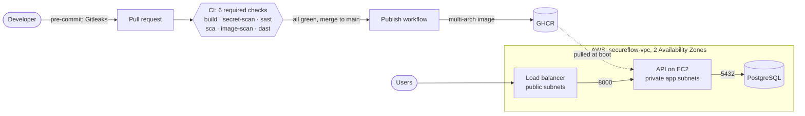
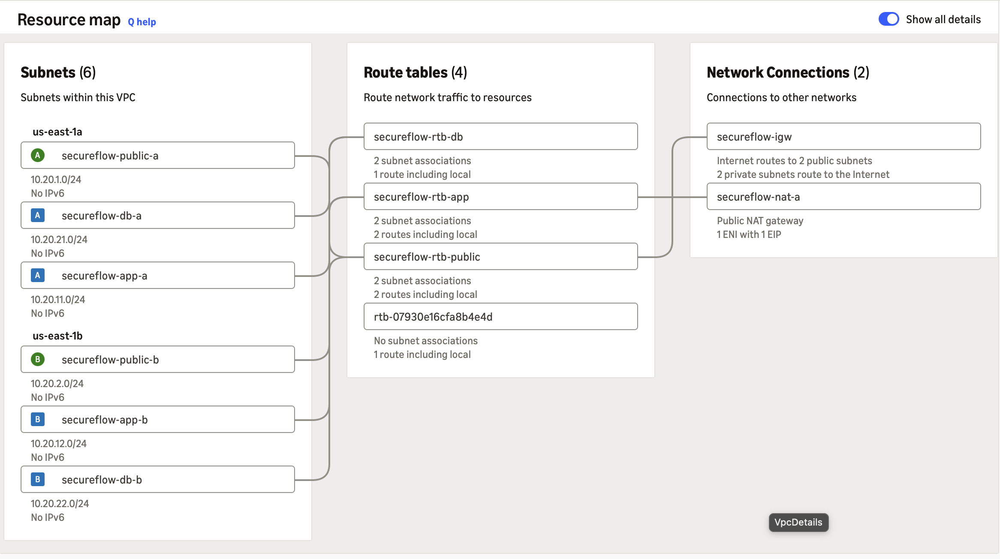

# SecureFlow

[](https://github.com/isl001/secureflow/actions/workflows/ci.yml)
[](https://github.com/isl001/secureflow/actions/workflows/publish.yml)
[](https://sonarcloud.io/summary/new_code?id=isl001_secureflow)
[](https://github.com/isl001/secureflow/releases)
[](LICENSE)

End-to-end **DevSecOps project**: a containerised FastAPI + PostgreSQL application goes from a
Git commit, through six automated security gates, to a published image that runs on AWS
in a private subnet behind a load balancer.

**Contents:** [Architecture](#architecture) · [Pipeline](#pipeline-current) · [Security controls](#security-controls) · [Quick start](#quick-start-local) · [AWS](#aws) · [Repository layout](#repository-layout) · [Roadmap](#roadmap)

## Architecture



- **Left side (automatic):** nothing reaches `main`, or the registry, without passing every gate.
- **Right side (AWS):** only the load balancer is public. The API has no public IP and no SSH; the database tier has no route to the internet.
- **Honest status:** the deploy step to AWS is manual today ([deploy lab](docs/deploy-aws-lab.md)), and in that lab PostgreSQL ran as a container next to the API. Next: RDS in the database subnets, HTTPS, and continuous deployment.

## Pipeline (current)

```
Developer ──► pre-commit (Gitleaks) ──► Pull Request ──► CI (6 required checks) ──► merge to main ──► Publish
                                                          │                                         │
                                                          ├─ build        (deps + syntax + docker)  └─ multi-arch image
                                                          ├─ secret-scan  (Gitleaks, full history)     (amd64 + arm64)
                                                          ├─ sast         (SonarCloud Quality Gate)    ──► GHCR
                                                          ├─ sca          (pip-audit, known CVEs)
                                                          ├─ image-scan   (Trivy on the built image)
                                                          └─ dast         (OWASP ZAP against the running app)
```

`main` is protected: no direct pushes, and a PR can only merge when **all six checks pass**.

| Workflow | Trigger | Job | What it does |
|---|---|---|---|
| `ci.yml` | pull request → `main` | `build` | Installs dependencies, compiles the app, builds the Docker image |
| | | `secret-scan` | Gitleaks scans the **entire Git history** (`fetch-depth: 0`, redacted output) |
| | | `sast` | SonarQube Cloud analysis; waits for the **Quality Gate** and fails the job if it fails |
| | | `sca` | `pip-audit` checks `requirements.txt` and `scripts/requirements.txt` against known vulnerabilities (OSV / PyPI advisories); `--strict` fails closed |
| | | `image-scan` | Builds the image and scans it with Trivy (OS packages + Python packages); fails on HIGH/CRITICAL issues that have a fix (`--ignore-unfixed`) |
| | | `dast` | Starts a throwaway app + database with Docker Compose (random password), smoke-tests it with `scripts/netcheck.sh`, runs an OWASP ZAP API scan from `/openapi.json`, uploads the HTML report as an artifact, then tears everything down |
| `publish.yml` | push → `main` | `publish` | Builds a multi-arch image and pushes it to GHCR tagged with the commit SHA and `latest` |

## Security controls

| Layer | Control | Status |
|---|---|---|
| Developer machine | Gitleaks pre-commit hook (blocks committed secrets) | ✅ |
| GitHub | Secret scanning + push protection | ✅ |
| GitHub | Dependabot alerts + security updates | ✅ |
| CI | Gitleaks scan of full history as a required check | ✅ |
| CI | SAST with SonarQube Cloud; Quality Gate is a required check ("Clean as You Code": judges new code) | ✅ |
| CI | SAST gate verified with a negative test (insecure code → merge **BLOCKED**) | ✅ |
| CI | SCA with `pip-audit` as a required check; verified with a negative test (vulnerable `idna` → merge **BLOCKED**) | ✅ |
| Supply chain | Third-party GitHub Actions pinned to full commit SHAs (immutable) | ✅ |
| Supply chain | `GITHUB_TOKEN` with least-privilege `permissions` (`contents: read`, `packages: write`) | ✅ |
| App | No default credentials: the app fails fast if `DATABASE_URL` is missing | ✅ |
| Config | Secrets kept out of Git: `.env` (git-ignored) + `.env.example`; Compose uses `${VAR:?}` | ✅ |
| Container | Slim base image, non-root user (UID 10001) | ✅ |
| Dependencies | Dependabot version updates (weekly) for GitHub Actions, pip and Docker; SHA pins are kept and bumped automatically | ✅ |
| Dependencies | Dependabot PRs get their own `SONAR_TOKEN` (Dependabot secrets store, separate token), so the SAST gate also runs on bot PRs | ✅ |
| Dependencies | Snyk monitors the repo (requirements files + Dockerfile) through the GitHub integration | ✅ |
| Container | Trivy scans the **built** image in CI as a required check (fixable HIGH/CRITICAL only) | ✅ |
| Supply chain | SBOM (CycloneDX) + image signing | ⏳ |
| Runtime | DAST: OWASP ZAP API scan in CI as a required check (fails on any warning) | ✅ |
| App | Input validation rejects control characters in task titles (found by ZAP: NUL byte caused a 500) | ✅ |
| App | Security headers on every response: `X-Content-Type-Options: nosniff`, `Cross-Origin-Resource-Policy: same-origin` | ✅ |
| Container | Base-image CVEs patched in the Dockerfile when the upstream image lags behind (zlib1g; verified with `dpkg-query` and Trivy) | ✅ |
| Cloud network | 3-tier VPC in 2 AZs; one route table per tier; database subnets have no route to the internet | ✅ |
| Cloud network | Security groups chained by SG ID (load balancer → API → database); no port 22 anywhere | ✅ |
| Cloud access | EC2 gets temporary credentials from an IAM role; shell access through Session Manager (IAM-controlled, logged); IMDSv2 required | ✅ (deploy lab) |
| Cloud | HTTPS at the load balancer (ACM certificate) | ⏳ |

### Triage decisions

| Finding | Decision | Reason |
|---|---|---|
| Hard-coded PostgreSQL password (`app/db.py`, `compose.yaml`) | **Fixed** | Moved to environment / `.env`; fail fast when missing |
| Actions referenced by mutable tags (`@v3`) | **Fixed** | Pinned to commit SHAs; tags can be force-moved (cf. tj-actions/changed-files, 2025) |
| Path traversal in `scripts/policy_check.py` | **False positive** | CLI run by developers/CI on repo files; caller already has the same permissions, so no trust boundary is crossed. Re-evaluate if ever exposed via an API |
| ZAP: `POST /tasks` returned 500 (NUL byte reached PostgreSQL) | **Fixed** | Pydantic pattern rejects control characters → 422 instead of 500 |
| ZAP: missing `X-Content-Type-Options` and `Cross-Origin-Resource-Policy` | **Fixed** | FastAPI middleware adds both headers to every response |
| Trivy: 2 HIGH CVEs in `zlib1g` on a PR that did not touch the Dockerfile | **Fixed** | New CVEs; checked that the latest `python:3.12-slim` still shipped the old package, then upgraded only `zlib1g` in the Dockerfile. To remove when the base image includes the fix |
| Unpinned / source installs in `pip install` | **Open** | Versions are pinned, but hash-locked installs (`--require-hashes`) are not done yet |

## Quick start (local)

Requirements: Docker with Compose v2.

```bash
git clone https://github.com/isl001/secureflow.git
cd secureflow

# 1. Create your local secrets file (never committed)
cp .env.example .env
sed -i.bak "s/^POSTGRES_PASSWORD=.*/POSTGRES_PASSWORD=$(openssl rand -hex 16)/" .env && rm .env.bak
chmod 600 .env

# 2. Run the stack
docker compose up -d --build

# 3. Check it
curl http://127.0.0.1:8000/health      # {"status":"ok"}
```

> **Note:** `POSTGRES_PASSWORD` is only applied when the database volume is first created.
> If you change it later, rotate it inside the database (`ALTER USER ... PASSWORD ...`)
> or recreate the volume (`docker compose down -v`, which **deletes the data**).

### API

| Method | Path | Description |
|---|---|---|
| `GET` | `/health` | Liveness check |
| `GET` | `/tasks` | List tasks |
| `POST` | `/tasks` | Create a task |
| `DELETE` | `/tasks/{task_id}` | Delete a task |

Interactive docs: http://127.0.0.1:8000/docs

## Troubleshooting tool: `scripts/netcheck.sh`

Checks a URL layer by layer and stops at the first layer that fails, so you know where to look:

```
$ ./scripts/netcheck.sh https://example.com
== Checking https://example.com (host=example.com, port=443)
[DNS ] example.com -> 104.20.23.154 ✅
[TCP ] port 443 is open ✅
[TLS ] certificate valid until Dec 25 22:56:35 2026 GMT ✅
[HTTP] GET https://example.com -> 200 ✅
All checks passed ✅
```

| Layer | What it checks | Typical failure |
|---|---|---|
| DNS | the name resolves to an IP (`dig`) | NXDOMAIN, wrong record |
| TCP | the port answers (`nc`), and tells **refused** from **timed out** | app not running / firewall or security group |
| TLS | the certificate is not expired or expiring within 30 days (`openssl -checkend`) | expired certificate |
| HTTP | the status code (`curl`), 4xx vs 5xx | wrong path or auth / server error |

Works on macOS and Linux (exit code 0 = all good, 1 = a layer failed, 2 = wrong usage).

## AWS

The network SecureFlow runs in on AWS (dev), built with the AWS CLI script [`infra/aws-cli/create-network.sh`](infra/aws-cli/create-network.sh). Full design: [`docs/network.md`](docs/network.md).

| Tier | Subnets (2 AZs) | Route to the internet | Security group (inbound) |
|---|---|---|---|
| public (ALB) | 10.20.1.0/24, 10.20.2.0/24 | Internet Gateway | 443 from `0.0.0.0/0` |
| app (API) | 10.20.11.0/24, 10.20.12.0/24 | none yet (NAT when deployed) | 8000 from the ALB's SG only |
| db (PostgreSQL) | 10.20.21.0/24, 10.20.22.0/24 | never | 5432 from the API's SG only |

- One route table per tier, so a change for the app tier never gives the database a path to the internet.
- Security groups are chained by SG ID (not IPs), and no port 22 is open anywhere.
- Everything built so far is free; NAT Gateway and load balancer costs are added only during deploy labs.
- First deployment lab (EC2 + ALB, Session Manager, IMDSv2, health-check negative test, full cleanup): [`docs/deploy-aws-lab.md`](docs/deploy-aws-lab.md).

The VPC as AWS draws it (public subnets → Internet Gateway, app subnets → NAT during the lab, database subnets → local only):



## Repository layout

```
app/                     FastAPI application (API + database access)
scripts/                 netcheck.sh (layer-by-layer network check), policy_check.py
infra/aws-cli/           create-network.sh (builds the AWS network)
docs/                    network.md (design), deploy-aws-lab.md (deployment evidence), images/
.github/workflows/       ci.yml (6 required checks), publish.yml (image → GHCR)
.github/dependabot.yml   weekly updates for GitHub Actions, pip and Docker
Dockerfile               non-root image
compose.yaml             local stack: API + PostgreSQL (secrets from .env)
```

## Roadmap

**Done**
- [x] Repo + secret scanning (pre-commit, push protection)
- [x] FastAPI app + PostgreSQL with Docker Compose (healthcheck)
- [x] Non-root Dockerfile, multi-arch image published to GHCR
- [x] CI with 6 required checks: build, secret-scan, SAST, SCA, image scan, DAST (each proven with a negative test)
- [x] Supply chain: actions pinned to SHAs, Dependabot (actions, pip, docker), Snyk monitoring
- [x] Layer-by-layer network check script (`netcheck.sh`) used as a CI smoke test
- [x] AWS network: 3-tier VPC in 2 AZs with chained security groups (AWS CLI)
- [x] Deploy lab on AWS: private EC2 (no SSH) behind an ALB, then cleaned up

**Next**
- [ ] Production-style AWS deploy: HTTPS (ACM), RDS, Auto Scaling across 2 AZs
- [ ] Terraform: the same AWS infrastructure as code + IaC scanning
- [ ] SBOM + image signing (Cosign), security reports
- [ ] Kubernetes + ArgoCD (GitOps, continuous deployment)
- [ ] Prometheus + Grafana, Ansible

## Tech

GitHub Actions · Docker · GHCR · Gitleaks · SonarQube Cloud · pip-audit · Snyk · Trivy · OWASP ZAP · Python · FastAPI · PostgreSQL · Bash · AWS (VPC, EC2, ALB, IAM, Systems Manager)

*Planned:* Terraform · Kubernetes · ArgoCD · Ansible · Prometheus · Grafana
