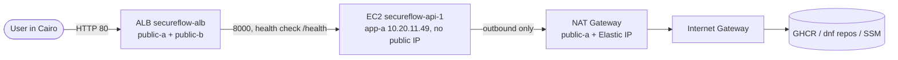
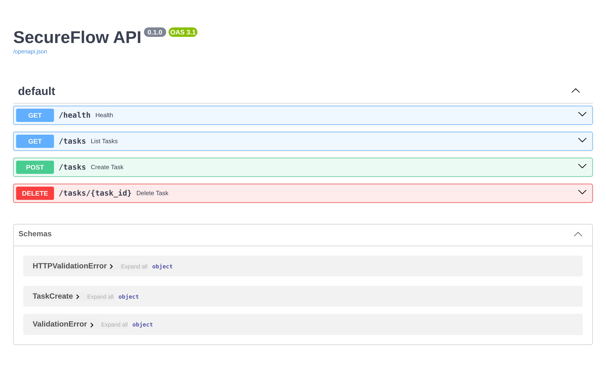
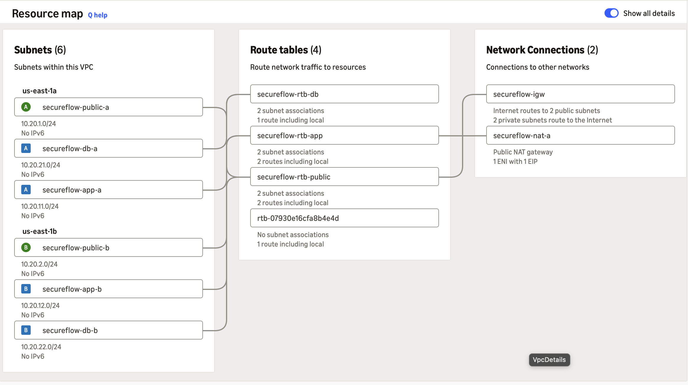
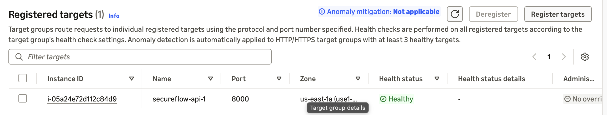

# Lab: SecureFlow running on AWS (EC2 + ALB) — 2026-11-12

A one-session lab that deployed the published image `ghcr.io/isl001/secureflow-api:latest`
into the [SecureFlow network](network.md), tested it from the internet, then deleted everything that costs money.

## What was built



| Piece | Choice | Why |
|---|---|---|
| Server | EC2 t3.micro, Amazon Linux 2023, in `app-a`, **no public IP** | only reachable through the ALB |
| Access | IAM role `secureflow-ec2-ssm` (AmazonSSMManagedInstanceCore) + Session Manager | no SSH, no port 22, no keys; every session logged under the IAM user |
| Metadata | IMDSv2 required (`HttpTokens=required`) | protects the role's temporary credentials from SSRF |
| Boot | User Data: install Docker, random DB password generated on the server, run `postgres:17` + our image | nothing secret in Git or in chat |
| Outbound | NAT Gateway in `public-a`, route `0.0.0.0/0 → NAT` in `secureflow-rtb-app` only | app pulls images/updates; `secureflow-rtb-db` stays local-only |
| Entry point | ALB in 2 public subnets → target group on 8000, health check `GET /health` | the only public part; security group chain alb → api |

Lab-only compromises (to fix in a real deployment):
- HTTP on port 80, no TLS (needs a domain + ACM certificate; production = HTTPS 443 + redirect).
- PostgreSQL runs as a container on the same server, not in the db subnets (next: RDS).
- One instance in one AZ (next: Auto Scaling across `app-a` and `app-b`).

## Evidence

The API answering through the ALB's public DNS name:


The API docs page, served from AWS:



AWS's own resource map of `secureflow-vpc` (public → IGW, app → NAT, db → local only, main route table unused):



The target is healthy behind the ALB:



Checks from the terminal:

```text
$ curl -s http://<alb-dns>/health
{"status":"ok"}

$ ./scripts/netcheck.sh http://<alb-dns>/health
[DNS ] <alb-dns> -> 23.21.218.28 ✅
[TCP ] port 80 is open ✅
[TLS ] skipped (plain http, no certificate) ✅
[HTTP] GET http://<alb-dns>/health -> 200 ✅
All checks passed ✅
```

## Negative test: the app goes down

`sudo docker stop api` (through Session Manager), then:

| Time | ALB view of the target | What users got | Why |
|---|---|---|---|
| first seconds | still healthy | **502** | ALB forwards, port 8000 refuses |
| after 3 failed checks | unhealthy (`Target.FailedHealthChecks`) | **502** | all targets unhealthy → ALB *fails open* and still forwards |
| `docker start api` + 2 good checks | healthy | **200** | traffic flows again |

Lesson: with a single target, an app crash shows as 502, not 503. A 503 means the target group has no targets at all.

## Cleanup (verified)

Deleted: listener, ALB, target group, EC2 (root disk with it), the NAT route in `secureflow-rtb-app`, NAT Gateway, Elastic IP, and the lab-only port 80 rule.
Kept (free): VPC, subnets, IGW, route tables, security groups, IAM role.

```text
Running EC2: 0 | NAT GWs: 0 | Elastic IPs: 0 | Load balancers: 0 | EBS volumes: 0
secureflow-rtb-app: 10.20.0.0/16 local active   (no blackhole route)
```

Approximate cost of the lab: well under $1 (NAT ~75 min, ALB ~30 min, t3.micro ~45 min).
