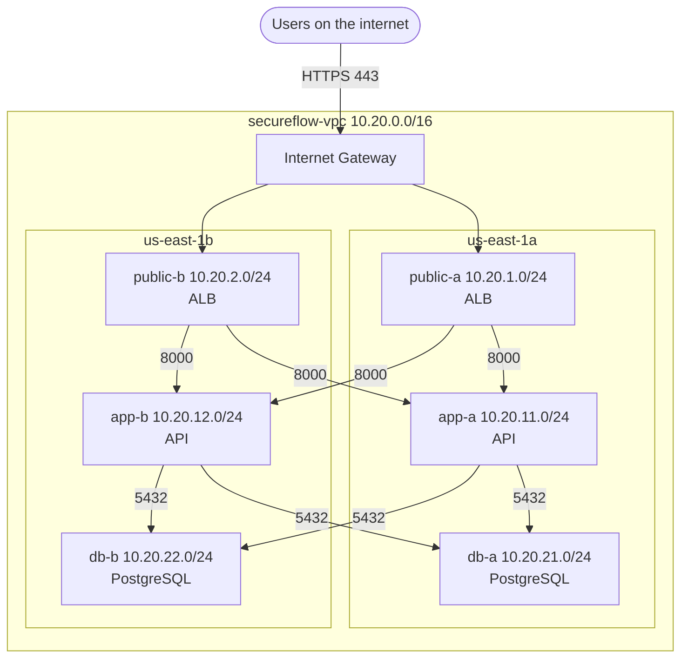

# SecureFlow AWS network

The network SecureFlow will run in on AWS (region `us-east-1`, environment `dev`).
It is built today with the AWS CLI script [`infra/aws-cli/create-network.sh`](../infra/aws-cli/create-network.sh).
Later it will be rebuilt with Terraform.

## Requirements (ticket #7001)

- The API is reachable from the internet, but only through a load balancer.
- The database is never reachable from the internet.
- The app keeps working if one Availability Zone (AZ) fails.

## Design



## IP plan

| Tier | AZ a | AZ b | Route table | Internet |
|---|---|---|---|---|
| public | 10.20.1.0/24 | 10.20.2.0/24 | `secureflow-rtb-public` | in and out through the IGW |
| app | 10.20.11.0/24 | 10.20.12.0/24 | `secureflow-rtb-app` | none yet (outbound through a NAT Gateway when deployed) |
| db | 10.20.21.0/24 | 10.20.22.0/24 | `secureflow-rtb-db` | never |

- `10.20.0.0/16` does not overlap the default VPC (`172.31.0.0/16`) or other lab networks, so the VPCs can be connected later.
- The third number shows the tier: `10.20.1x` = app, `10.20.2x` = database.
- Each `/24` has 256 addresses; AWS reserves 5 in every subnet, so 251 are usable.

## Route tables

| Route table | Routes | Subnets |
|---|---|---|
| `secureflow-rtb-public` | `10.20.0.0/16 → local`, `0.0.0.0/0 → igw` | public-a, public-b |
| `secureflow-rtb-app` | `10.20.0.0/16 → local` | app-a, app-b |
| `secureflow-rtb-db` | `10.20.0.0/16 → local` | db-a, db-b |
| main (unused) | `10.20.0.0/16 → local` | none |

Why:
- A subnet is public only because its route table sends `0.0.0.0/0` to the Internet Gateway.
- Each tier has its own route table. Adding a NAT route for the app later cannot give the database a path to the internet.
- The main route table is kept private and unused, so a new subnet is never public by accident.
- All subnets in the VPC reach each other through the `local` route; security groups decide who may talk.

## Security groups (chained)

| Security group | Inbound | Why |
|---|---|---|
| `secureflow-alb` | TCP 443 from `0.0.0.0/0` | users reach the app only through the load balancer |
| `secureflow-api` | TCP 8000 from `secureflow-alb` | only the load balancer can call the API |
| `secureflow-db` | TCP 5432 from `secureflow-api` | only the API can reach PostgreSQL |

- Rules use security groups as the source, not IP addresses, so new instances from Auto Scaling are allowed automatically.
- Security groups are stateful: replies are allowed automatically.
- There is no port 22 anywhere. Shell access will use AWS Systems Manager Session Manager (IAM-controlled and logged).
- Outbound is still the AWS default (allow all). It will be narrowed when the app is deployed.
- Network ACLs: the default NACL (allow all) is kept; access control is done with security groups.

## Cost

Everything in this design is free. The parts that cost money will be added only when SecureFlow is deployed, and removed after each lab:

| Resource | Approximate cost |
|---|---|
| NAT Gateway | about $0.045/hour (~$32/month) + data |
| Application Load Balancer | about $0.0225/hour (~$16/month) + usage |
| Public IPv4 / Elastic IP | about $0.005/hour each |

A zero-spend AWS Budget alerts on any charge.

## How to build it

```bash
# in AWS CloudShell (or any shell with the AWS CLI and admin rights)
./infra/aws-cli/create-network.sh
source ~/secureflow-net.env   # reload the saved IDs in a new shell
```

The script stops without creating anything if `secureflow-vpc` already exists.
